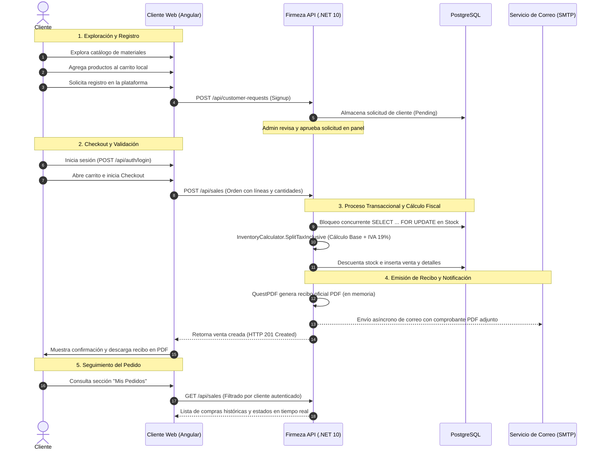

# Flujo de Compra del Cliente y Gestión Comercial

Este documento describe la arquitectura funcional y técnica del ciclo completo de compra para clientes en **Firmeza Materiales**, desde la navegación por el catálogo hasta la entrega del comprobante electrónico y seguimiento de órdenes.

---

## Fases del Proceso

### 1. Exploración y Carrito de Compras en el Navegador
- **Almacenamiento Local**: El carrito vive íntegramente en el cliente mediante **Angular Signals** y estado en memoria/almacenamiento del navegador. No se crean tablas temporales ni sesiones de carrito huérfanas en la base de datos relacional.
- **Validaciones en Cliente**: Control preventivo de cantidades positivas y verificación de stock reportado por el catálogo antes de enviar la orden.

### 2. Acceso y Registro de Clientes
- **Solicitud de Registro**: Clientes nuevos completan el formulario en `/register` enviando documento (NIT/Cédula), nombre o razón social, correo, teléfono y dirección.
- **Aprobación Administrativa**: La solicitud queda en estado `Pending`. El administrador revisa y aprueba la cuenta desde el módulo de *Solicitudes de Clientes*, momento en el cual se genera automáticamente el usuario en Identity y el perfil comercial en `customers`.
- **Notificación de Aprobación**: Se despacha un correo de bienvenida con las credenciales de acceso activas.

### 3. Ejecución Transaccional del Pedido (`POST /api/sales`)
Cuando el cliente presiona **"Confirmar y Pagar"**:
1. **Verificación de Identidad**: El token Bearer identifica al cliente autenticado (`CurrentUserService`).
2. **Control de Concurrencia de Inventario**:
   - Se ejecuta una transacción en base de datos con nivel de aislamiento y bloqueo exclusivo `SELECT ... FOR UPDATE` sobre los registros de `products` involucrados.
   - Si no hay suficiente inventario para alguna línea, la transacción se revierte (`ROLLBACK`) y se responde con `400 Bad Request` indicando el producto agotado.
3. **Cálculo Fiscal Automático**:
   - Todo precio registrado incluye IVA.
   - El dominio (`InventoryCalculator.SplitTaxInclusive`) calcula matemáticamente la base gravable y el IVA discriminado al 19% con precisión monetaria (dos decimales, redondeo bancario).
   - Los valores calculados quedan grabados en la venta y sus detalles.

### 4. Generación de Recibo Oficial y Correo Electrónico
- **Generador QuestPDF (`ReceiptService`)**:
  - Genera el comprobante oficial en formato PDF vectorial.
  - El diseño cuenta con la paleta corporativa azul, número de serie único (`VTA-YYYYMMDD-XXXXXX`), desglose de materiales, liquidación de impuestos y términos y condiciones.
  - La cabecera se genera en el bloque de contenido garantizando que, incluso en ventas de muchas líneas, el encabezado oficial no se duplique en hojas secundarias.
- **Despacho por Correo Electrónico (`IMailService`)**:
  - El recibo generado en memoria se adjunta directamente al correo electrónico de notificación.
  - **Tolerancia a fallos**: El envío se ejecuta dentro de un bloque seguro. Si el servidor SMTP externo experimenta indisponibilidad o demora, la venta **no se cancela**; la falla se registra en el log del sistema y el cliente puede seguir descargando su recibo desde la interfaz web.

### 5. Seguimiento en "Mis Pedidos"
- El cliente dispone de la ruta `/mis-pedidos` en el portal web.
- Puede ver el histórico de sus órdenes, estado actual (`Pendiente`, `Confirmada`, `Entregada` o `Cancelada`), desglose de ítems comprados, notas emitidas por el administrador en caso de decisiones especiales y botón de re-descarga directa del recibo PDF en cualquier momento.
